# Diagnostic Patient Analysis Dashboard

## Project Overview
A real-world Power BI analytics and management reporting solution designed to monitor diagnostic operations, patient activity, referral performance, laboratory and radiology performance, and report delivery status.
The dashboard transforms operational data into interactive reports, KPIs, trends, and analytical insights to support data-driven management decisions.

## Dashboard Preview

### 1. Information Page
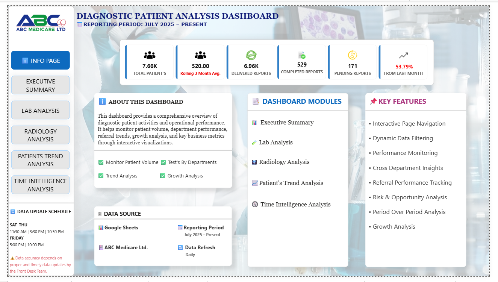

### 2. Executive Summary
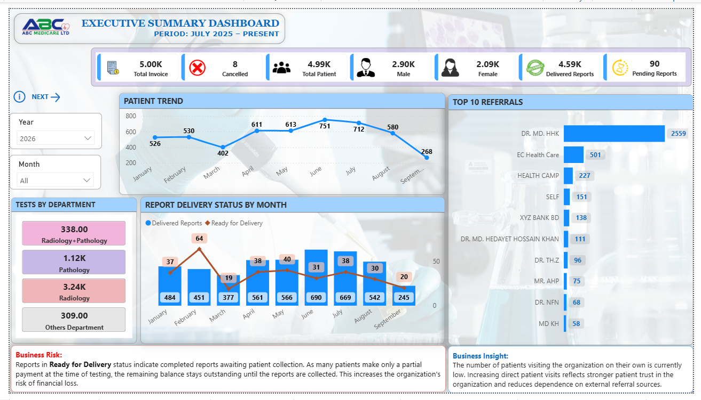

### 3. Drill Through Analysis
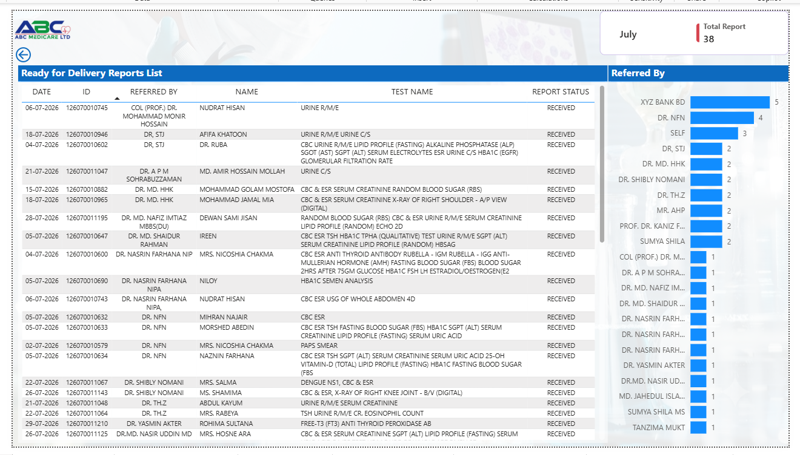

### 4. Lab Analysis
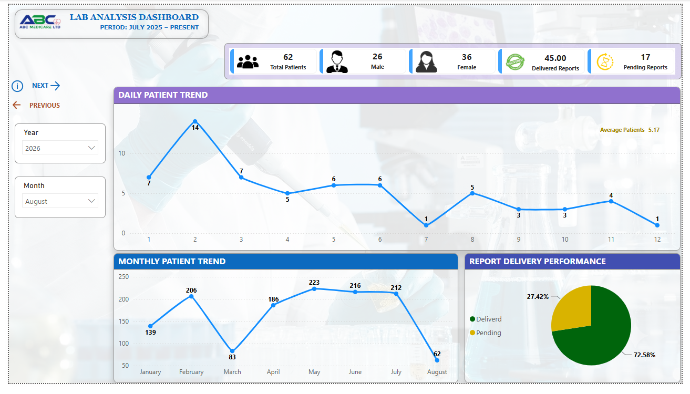

### 5. Radiology Analysis
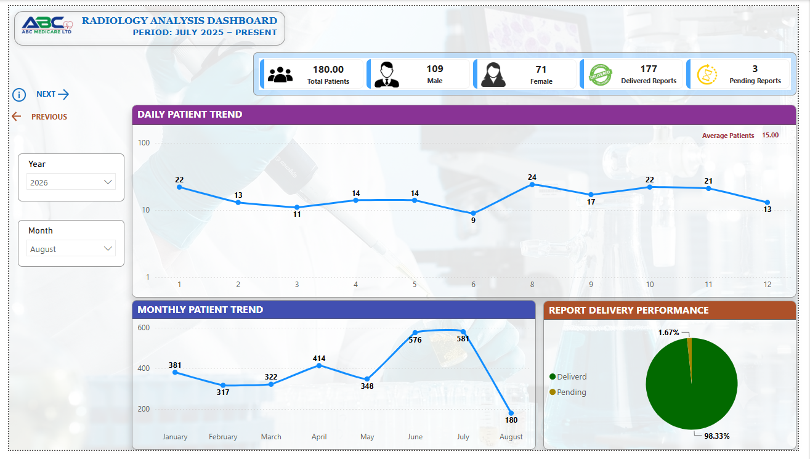

### 6. Patients Trend Analysis – 1
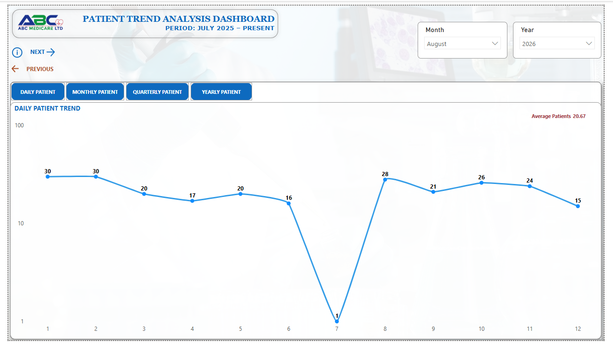

### 7. Patients Trend Analysis – 2
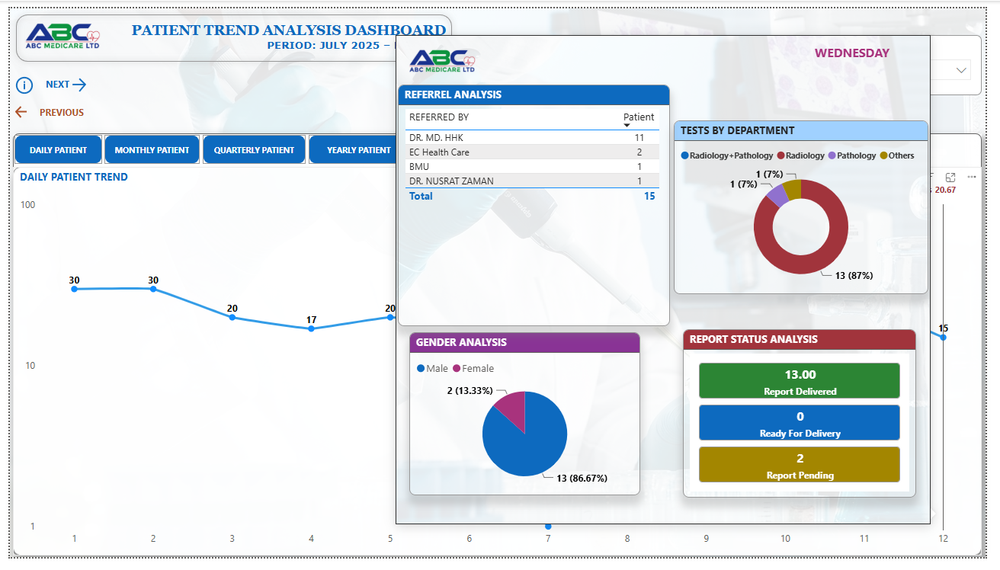

### 8. Patients Trend Analysis – 3

### 9. MTD Analysis
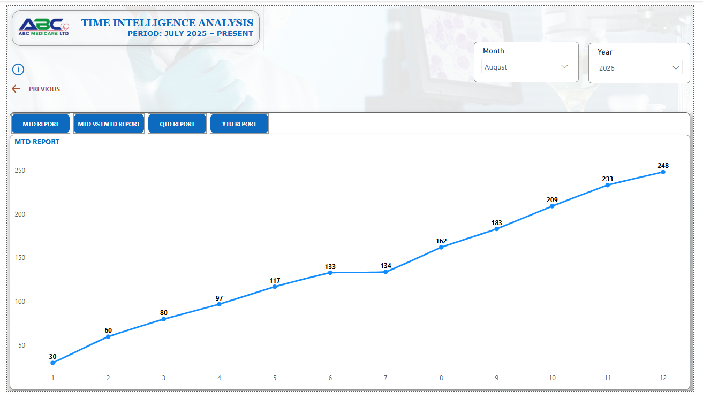

### 10. MTD vs LMTD Analysis

### 11. QTD Analysis
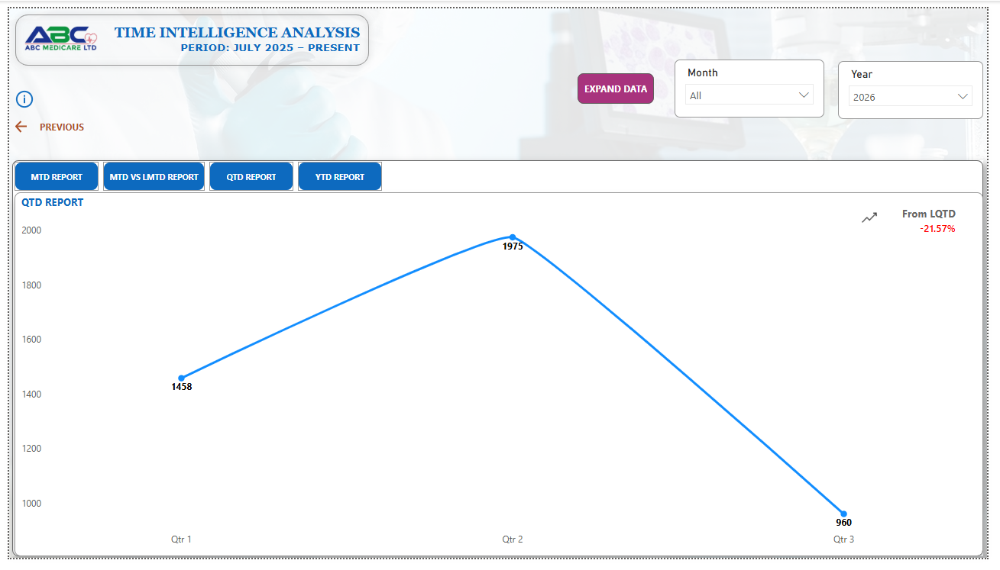

### 12. QTD Expand Analysis
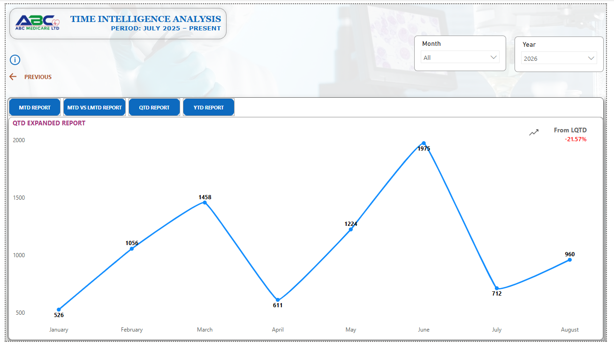

### 13. YTD Analysis
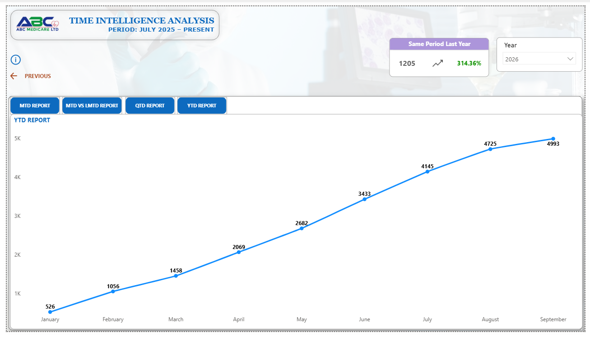

## Business Objectives
- Monitor overall patient volume and operational performance.
- Analyze daily, monthly, quarterly, and yearly patient trends.
- Track laboratory and radiology performance.
- Identify top-performing referral sources.
- Monitor report delivery and pending reports.
- Compare current performance with previous periods.
- Identify business risks and opportunities.
- Support management decision-making through analytical reporting.

## Dashboard Modules
1. Executive Summary
2. Lab Analysis
3. Radiology Analysis
4. Patient Trend Analysis
5. Time Intelligence Analysis

## Tools & Technologies
- Microsoft Power BI
- DAX
- Power Query
- Google Sheets

## Data Workflow
Google Sheets → Power Query → Data Cleaning & Transformation → Data Model → DAX Measures → Power BI Dashboard → Management Insights

## Key Features
- Interactive navigation and dynamic filtering.
- Daily, monthly, quarterly, and yearly trend analysis.
- Patient volume and department performance monitoring.
- Referral performance analysis.
- Report delivery and pending report tracking.
- Current-period and previous-period comparisons.
- MTD, QTD and YTD analysis.

## Reporting Period
July 2025 – Present

## Project Focus
Data Transformation → Data Modeling → DAX → Visualization → Business Analysis → Management Reporting

## Project Files
- `Dashboard_Screenshorts/` – Selected dashboard screenshots.
- `Power_BI_File/` – Power BI project file (.pbix).

## Disclaimer
This project is presented for portfolio and demonstration purposes. 
All confidential, personal, and patient-identifiable information must be removed or anonymized before public distribution.

##Author
MD FAHIM

